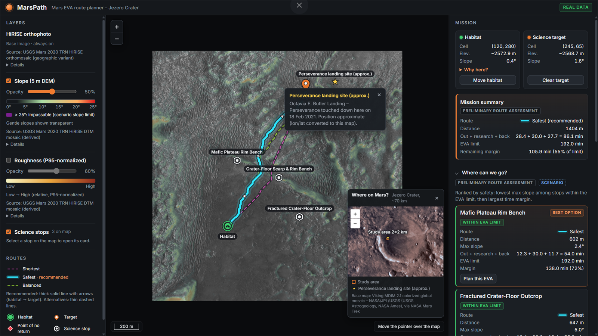
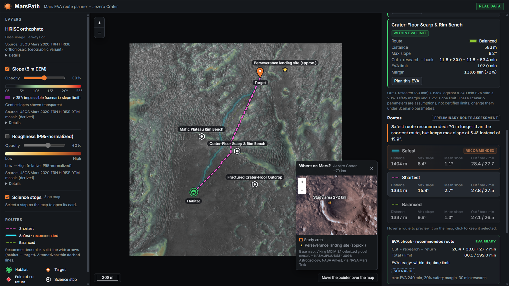
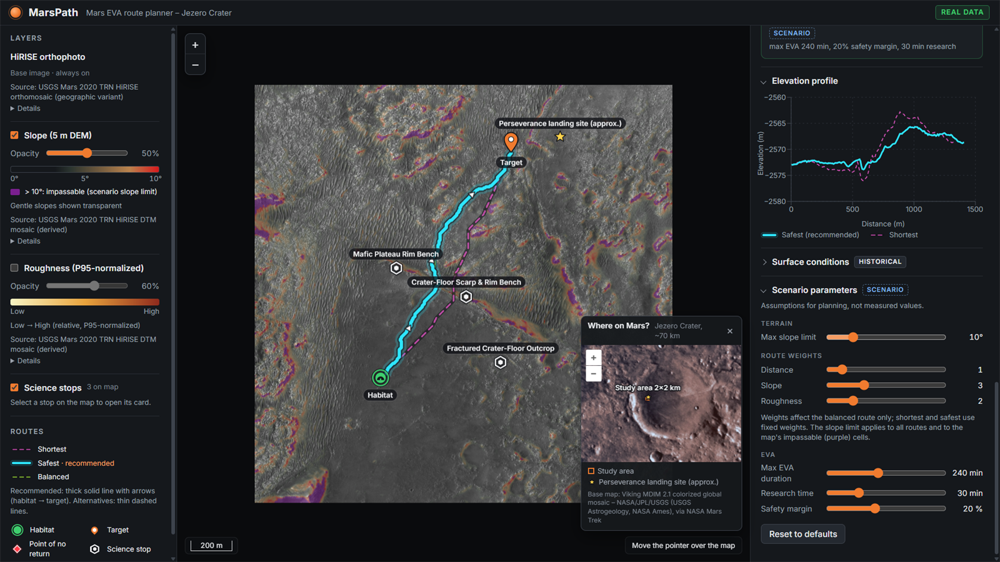
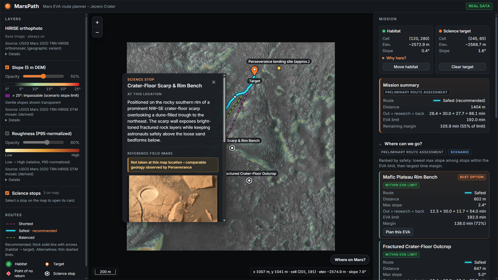
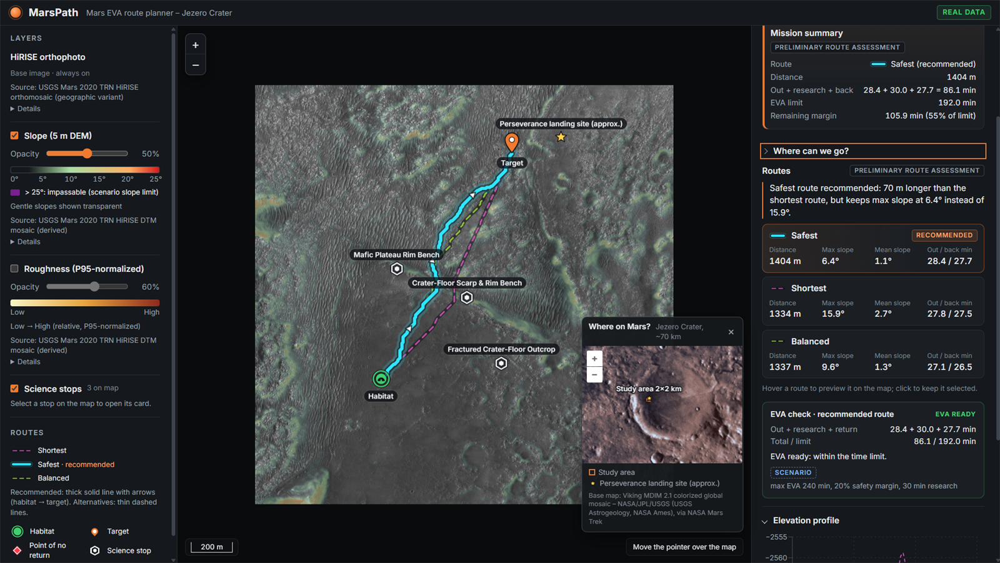
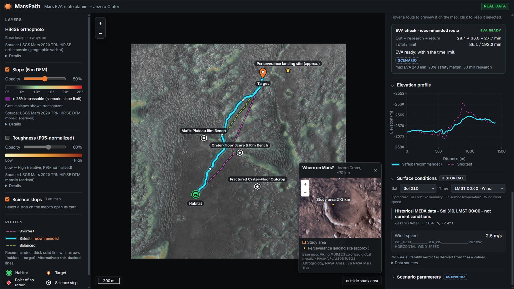
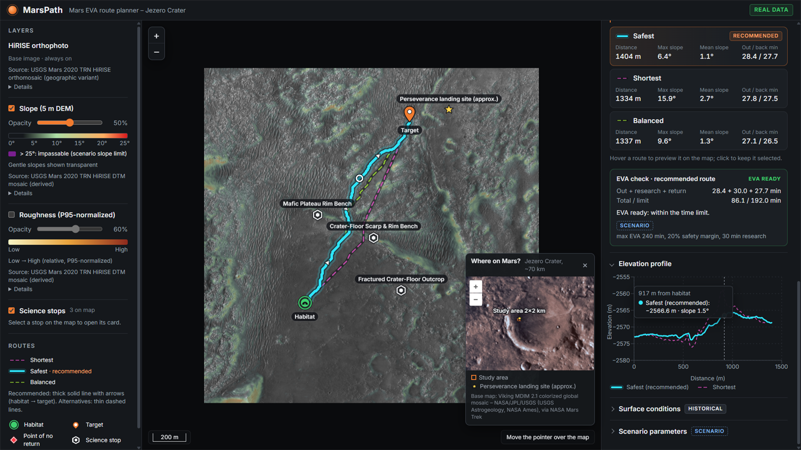
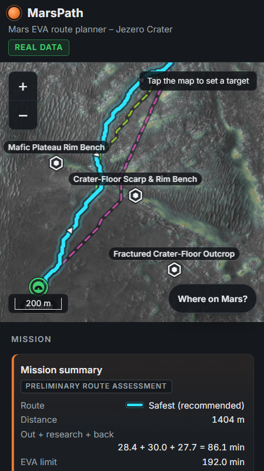

# MarsPath – Mars EVA Route Planner (Jezero Crater)

**Team LUNA 9 · NASA Space Apps Challenge 2026 · Challenge: Interplanetary Survival Guide: Martian Map · Sakarya local event**

Challenge page: https://www.spaceappschallenge.org/2026/challenges/interplanetary-survival-guide-martian-map/

## Live demo

- **Main:** https://luna-9.vercel.app
- **Mirror:** https://luna9-marspath.netlify.app

> *.vercel.app is unreachable on some mobile networks; the Netlify mirror serves the same build.

## Screenshots

| | |
| --- | --- |
|  **01 – Overview.** Map with layers, the three routes, science stops, the Perseverance landing site, the "Where on Mars?" inset, mission summary and "Where can we go?". |  **02 – Route highlight.** One route selected on the map; the others fade out. |
|  **03 – Slope limit 10°.** The scenario slope limit is lowered; cells above it turn purple (impassable) and the routes are recomputed. |  **04 – Science stop card.** What is at the map point, plus a Perseverance reference image with its image ID, sol, camera and credit. |
|  **05 – Where can we go?** Reachability of every science stop from the habitat, ranked by safety. |  **06 – Surface conditions.** A historical MEDA measurement (sol, LMST, source file), with "not current conditions" and "no EVA verdict" notes. |
|  **07 – Elevation profile.** Elevation along the recommended route compared with an alternative. |  **08 – Mobile layout.** The same app on a phone-sized screen. |

## What it does

An astronaut walking on Mars has a limited suit time and no room for error: a route that is short on the map can cross steep or rough ground, and the walk back must fit in the same time budget. MarsPath lets the user pick a habitat and a science target in a ~2 × 2 km area of Jezero Crater and computes walking (EVA) routes on real NASA/USGS terrain data. It compares a shortest, a safest and a balanced route, estimates outbound and return walking time with Tobler's hiking function adjusted for a spacesuit, and checks the whole EVA (out + research + back) against a time limit with a safety margin. It also shows which science stops can be reached from the habitat, reference images from Perseverance, and historical weather measurements from the rover's MEDA instrument. Everything runs in the browser on pre-processed static data; results are a **preliminary route assessment**, not a certified safe route.

## Features

- **Three routes and a recommendation** – *Shortest* (distance only), *Safest* (high slope and roughness weights) and *Balanced* (the user's weights). One route is recommended and the reason is stated in one sentence. Routes can be hovered or selected on the map and in the route cards.
- **EVA check and point of no return** – outbound + research + return time is compared with the EVA limit after the safety margin ("EVA ready" when within the limit). If the limit is exceeded, the map marks the *point of no return*.
- **Scenario sliders** – max slope limit (5–30°), route weights for distance, slope and roughness (0–10), max EVA duration (60–480 min), research time (0–120 min) and safety margin (0–50 %). All are labelled *scenario* in the UI.
- **Mission summary** – route, distance, out + research + back time, EVA limit and remaining margin for the current plan.
- **"Where can we go?"** – for every science stop: status (within EVA limit / over EVA limit / no safe route), route, distance, max slope, times and margin; a safety ranking with a "Best option" badge and a "Plan this EVA" button.
- **Science stops and reference images** – each stop card describes what is at the map point and shows a Perseverance Mastcam-Z reference image of comparable geology, with image ID, sol, camera, credit and sources.
- **Elevation profile** – elevation along the routes (Recharts).
- **Historical MEDA conditions** – pressure, relative humidity, sensor temperature and wind speed for a selected sol and LMST time, always marked *Historical*, with the source file and column.
- **"Where on Mars?" overview** – a ~70 km view of Jezero Crater on the NASA Mars Trek Viking MDIM 2.1 colour mosaic, showing the 2 × 2 km study area. If the live tiles do not arrive within 5 s, a saved crop of the same layer is shown and marked "(saved copy)".
- **Perseverance landing site** – Octavia E. Butler Landing marked on the main map and the overview (position approximate).
- **Layers and legends** – HiRISE orthophoto base image, slope and roughness layers with opacity sliders and legends, routes and map symbols legend, and source details for each layer.
- **Mobile layout** – the same features on a phone-sized screen.

## How it works

### Data pipeline (`data-pipeline/`, Python)

- **Inputs:** the USGS Mars 2020 TRN HiRISE DTM mosaic (1 m) and HiRISE orthomosaic (25 cm) of Jezero Crater (see [Data sources](#data-sources--credits)).
- **Study area:** 2000 × 2000 m, bounds 77.42613–77.45987° E, 18.41512–18.44886° N (`grid.json` → `source.boundsLonLat`), in the Equirectangular Mars 2000 Sphere IAU projection.
- **Grid:** 400 × 400 cells, **5 m** cell size. The DEM is aligned and resampled to this grid with bilinear resampling (`dem_pipeline/alignment.py`); the orthophoto is exported separately at 1600 × 1600 px (1.25 m per pixel), warped directly from the source.
- **Slope:** central differences along the row/column axes (one-sided at edges and next to missing data), `slope = degrees(atan(hypot(dz/dx, dz/dy)))`.
- **Roughness:** population standard deviation of elevation in the 3 × 3 window around each cell (valid cells only, centre included).
- **Output:** `frontend/public/data/grid.json` (elevation, slope, roughness arrays and statistics), `layers.json`, `ortho.png`, `slope.png`, `roughness.png`. In the current data, elevation ranges from −2592.56 to −2533.77 m, the steepest cell is 20.2° and the 95th-percentile roughness is 0.55 m.
- **MEDA:** `meda_pipeline.py` exports a deterministic subset of derived MEDA pressure, relative humidity and wind products to `meda.json` (sols 301, 310, 320, 420, 426, 431). Per file and field, the first valid row in each of six 4-hour LMST bins is kept; nothing is interpolated or averaged. See `data-pipeline/MEDA_README.md`.

### Route engine (`frontend/src/routing/`, TypeScript)

- **A\*** on the grid with **8-neighbour** moves; a diagonal move is not allowed if either of the two adjacent straight cells is impassable.
- **Passable cells:** valid data and slope ≤ the scenario slope limit (default **25°**).
- **Step cost:** `d · (α + terrain(a)/2 + terrain(b)/2)`, where `d` is the step length (5 m or 5√2 m) and
  `terrain = β · slope / maxSlope + γ · min(roughness / roughnessP95, 1)`.
  Default weights (`DEFAULT_OPTIONS`): α (distance) = 1, β (slope) = 3, γ (roughness) = 2. α is kept ≥ 0.1. The heuristic is straight-line distance × α.
- **Alternatives:** *Shortest* uses β = γ = 0; *Safest* uses α = 1, β = max(10, user β), γ = max(10, user γ); *Balanced* uses the user's weights. All three use the user's slope limit.
- **Recommendation rule:** among routes that were found, the one with the lowest **maximum slope**, then lowest **mean slope**, then shortest **round-trip time**, then shortest **distance**; ties prefer balanced, safest, shortest.
- **Walking time:** Tobler's hiking function scaled by a spacesuit factor `SUIT_FACTOR = 0.6`:
  `minutes = d / (100 · 0.6) · exp(3.5 · |grade + 0.05|)` per step (`grade` = elevation change / step length; 100 m/min = 6 km/h). Outbound and return times are computed separately along the same path, because uphill and downhill differ.
- **EVA model:** `DEFAULT_EVA_PROFILE` = max EVA 240 min, research 30 min, safety margin 20 %. EVA limit = max EVA × (1 − margin), i.e. 192 min by default. Total = outbound + research + return; "within limit" if total ≤ limit.
- **Point of no return:** when the total exceeds the limit, the last point along the route where walking there and back still fits in the limit.

### "Where can we go?" ranking (`frontend/src/panels/reachability.ts`)

For each science stop the recommended route and its EVA check are computed. Stops are sorted: within the EVA limit → over the limit → no safe route; then by lowest max slope (compared at 0.1°); then by largest time margin. The first stop within the limit is marked "Best option". This is an accessibility/safety ranking only: it does not weigh scientific value and does not use MEDA data.

### Habitat site

The default habitat is cell (120, 280); the default target, cell (245, 65), is a demo choice. Rationale from the team's science lead (`frontend/src/config/mission.ts`), quoted:

> Cell (120, 280) is selected over Cell (306, 318) (5.4° slope) because habitat deployment requires ground slopes strictly under 5° for module leveling and airlock stability. Located on the flat, consolidated dark mafic crater-floor plain at a 0.4° slope, it provides safe standoff distance from steep western delta scarps and loose sand dunes.

### Web Workers

Route searches run in a Web Worker (`services/routeWorker.ts`) so the map and panels stay responsive; a second worker (`services/reachWorker.ts`) computes the routes to all science stops for "Where can we go?".

## Data sources & credits

### Terrain (USGS / NASA)

| Data | Provider | File | DOI / link |
| --- | --- | --- | --- |
| HiRISE DTM mosaic (1 m) | USGS Mars 2020 TRN HiRISE DTM mosaic | `JEZ_hirise_soc_006_DTM_MOLAtopography_DeltaGeoid_1m_Eqc_latTs0_lon0_blend40.tif` | https://doi.org/10.5066/P9REJ9JN · [archive file](https://asc-pds-services.s3.us-west-2.amazonaws.com/mosaic/mars2020_trn/HiRISE/JEZ_hirise_soc_006_DTM_MOLAtopography_DeltaGeoid_1m_Eqc_latTs0_lon0_blend40.tif) |
| HiRISE orthomosaic (25 cm, geographic variant) | USGS Mars 2020 TRN HiRISE orthomosaic | `JEZ_hirise_soc_006_orthoMosaic_25cm_Eqc_latTs0_lon0_first_dd.tif` | https://doi.org/10.5066/P9QJDP48 · [archive file](https://asc-pds-services.s3.us-west-2.amazonaws.com/mosaic/mars2020_trn/HiRISE/JEZ_hirise_soc_006_orthoMosaic_25cm_Eqc_latTs0_lon0_first_dd.tif) |

Slope and roughness layers are derived from the DTM.

### Perseverance reference images

Credit: NASA/JPL-Caltech/ASU

| Stop | Image ID | Sol | Camera |
| --- | --- | --- | --- |
| Fractured Crater-Floor Outcrop | [ZL0_0530_0713990263_223EBY_N0261222ZCAM08550_0340LMJ](https://mars.nasa.gov/mars2020/multimedia/raw-images/ZL0_0530_0713990263_223EBY_N0261222ZCAM08550_0340LMJ) | 530 | Mastcam-Z Left |
| Crater-Floor Scarp & Rim Bench | [ZR0_0507_0711941426_456EBY_N0261222ZCAM08527_1100LMJ](https://mars.nasa.gov/mars2020/multimedia/raw-images/ZR0_0507_0711941426_456EBY_N0261222ZCAM08527_1100LMJ) | 507 | Mastcam-Z Right |
| Mafic Plateau Rim Bench | [ZR0_0497_0711064436_394EBY_N0261004ZCAM08520_1100LMJ](https://mars.nasa.gov/mars2020/multimedia/raw-images/ZR0_0497_0711064436_394EBY_N0261004ZCAM08520_1100LMJ) | 497 | Mastcam-Z Right |

Stop content sources listed in `stops.json`: https://trek.nasa.gov/mars/, https://doi.org/10.3133/sim3292, https://science.nasa.gov/mission/mars-2020-perseverance/

### MEDA (Mars Environmental Dynamics Analyzer, Perseverance)

- Mars 2020 MEDA Pressure Sensor Derived Data
- Mars 2020 MEDA Relative Humidity Sensor Derived Data
- Mars 2020 MEDA Wind Sensor Derived Data

Source: [NASA PDS Atmospheres Node – Perseverance MEDA](https://pdsatmospheres.nmsu.edu/data_and_services/atmospheres_data/PERSEVERANCE/meda_08192021.html) (PDS bundle `urn:nasa:pds:mars2020_meda`, collection `urn:nasa:pds:mars2020_meda:data_derived_env`). DOI: not recorded in the data file.

### Overview base map

Base map: Viking MDIM 2.1 colorized global mosaic – NASA/JPL/USGS (USGS Astrogeology, NASA Ames), via [NASA Mars Trek](https://trek.nasa.gov/mars/) (layer `Mars_Viking_MDIM21_ClrMosaic_global_232m`, [WMTS capabilities](https://trek.nasa.gov/tiles/Mars/EQ/Mars_Viking_MDIM21_ClrMosaic_global_232m/1.0.0/WMTSCapabilities.xml); saved fallback crop retrieved 2026-11-15).

### Landing site

Octavia E. Butler Landing, 18.4447°N 77.4508°E – Perseverance touchdown 18 Feb 2021 (Mars 2020 mission records). Shown as an approximate position.

## Limitations

- **Preliminary route assessment.** Routes are a planning aid, not a certified safe route.
- **Scenario parameters are assumptions.** Route weights, the 25° slope limit, the spacesuit factor (0.6), the EVA duration, research time and safety margin are not measured values; they live in `frontend/src/routing/config.ts` and are labelled *scenario* in the UI.
- **5 m resolution.** Bilinear downsampling smooths local relief; rocks, small scarps and other obstacles smaller than a cell do not appear. Slopes describe the 5 m grid, not native-resolution hazards.
- **MEDA data is historical.** It shows past measurements for selected sols, not current weather. Air temperature, atmospheric opacity and Earth (UTC) dates are not available in the exported data; sensor temperature is not air temperature. No EVA suitability verdict is derived from these values. The site coordinate (77.443° E, 18.432° N) is an approximate regional reference, not the rover position on those sols.
- **Stop photos are references.** The Perseverance images show comparable geology; they were not taken at the stop locations.
- **Landing site position is approximate** (lon/lat converted to the map).
- **Source verification notes** (from the data files): the DEM and orthophoto were "processed from supplied local subset, not verified byte-identical to archive"; for the DEM, the "vertical reference not independently verified".

## Planned improvements

A future release of MarsPath will integrate a geological-unit overlay derived from the USGS geological map of Jezero Crater and Nili Planum (Sun & Stack, 2020; SIM 3464). The planned workflow includes extracting the relevant GIS layers, transforming them into the project's Mars coordinate reference system, clipping them to the 2 × 2 km study area, and exporting a GeoJSON layer with unit names and source attribution. This layer is not included in MarsPath v1.0. Geological unit boundaries will require spatial and scientific validation before publication.

## Tech stack

- **Frontend:** Vite, React, TypeScript, OpenLayers (`ol`), Recharts, Vitest
- **Data pipeline:** Python 3.11+, rasterio, NumPy, Pillow
- **Hosting:** Vercel (from `main`), Netlify mirror

## Project structure

```
Luna-9/
├── data-pipeline/           # Python: DEM alignment, terrain metrics, MEDA export (+ tests)
│   ├── dem_pipeline/        # raster reading, alignment, slope/roughness, export
│   ├── tests/               # unittest suites
│   ├── align_hirise.py      # Stage 1C: align DEM + orthophoto to the 400×400, 5 m grid
│   ├── export_mvp.py        # Stage 1D: write grid.json, layers.json and PNG layers
│   └── meda_pipeline.py     # historical MEDA subset → meda.json
├── docs/
│   ├── CONTRACT.md          # shared data formats, coordinate system, route API
│   └── screenshots/
└── frontend/
    ├── public/
    │   ├── data/            # grid.json, layers.json, meda.json, ortho/slope/roughness PNGs
    │   └── content/         # stops.json, stop images, overview fallback image
    └── src/
        ├── routing/         # A*, alternatives, Tobler, EVA check, scenario config
        ├── map/             # OpenLayers map, layers, markers, overview map
        ├── panels/          # mission, routes, reachability, conditions, scenario panels
        ├── services/        # data loading, Web Workers
        ├── config/          # habitat/target, landing site, route styles
        └── mocks/           # mock data used before the real data arrived
```

## Run locally

### Frontend

```bash
cd frontend
npm ci          # install dependencies from the lock file
npm run dev     # development server
npm test        # Vitest tests
npm run build   # production build
```

### Data pipeline

Requires Python 3.11+ with rasterio, NumPy and Pillow in a virtual environment at `.venv` in the repository root. Create the environment with `python -m venv .venv` and install the dependencies used by the pipeline: `.\.venv\Scripts\python.exe -m pip install numpy rasterio pillow` (no pinned versions; there is no requirements file yet). The raw GeoTIFFs and MEDA CSVs are not committed; place them under `data-pipeline/raw/` as expected by the scripts. Run from the repository root (Windows paths as in `data-pipeline/README.md`):

```powershell
# Tests
.\.venv\Scripts\python.exe -m unittest discover -s data-pipeline/tests -v

# Terrain: align, export, verify
.\.venv\Scripts\python.exe data-pipeline/align_hirise.py
.\.venv\Scripts\python.exe data-pipeline/export_mvp.py
node data-pipeline/verify_mvp.mjs

# MEDA
.\.venv\Scripts\python.exe data-pipeline/meda_pipeline.py
node data-pipeline/verify_meda.mjs
```

See `data-pipeline/README.md` and `data-pipeline/MEDA_README.md` for details.

## Team

| Role | Name |
| --- | --- |
| Person 1 – Frontend & UX | Ali Caner Sezer (GitHub: [@alicaners](https://github.com/alicaners)) |
| Person 2 – Data pipeline & routing | Faruk Turnalı (GitHub: [@farukk06](https://github.com/farukk06)) |
| Person 3 – Science content & validation | Civancan Aktaş |

Team page: https://www.spaceappschallenge.org/2026/find-a-team/luna-9/

## Use of AI tools

Frontend developed with Claude Code (Anthropic); data pipeline and routing with OpenAI Codex. All outputs were reviewed, tested (Vitest and Python tests) and validated by the team. No AI-generated images are used; all imagery comes from NASA/USGS sources.
